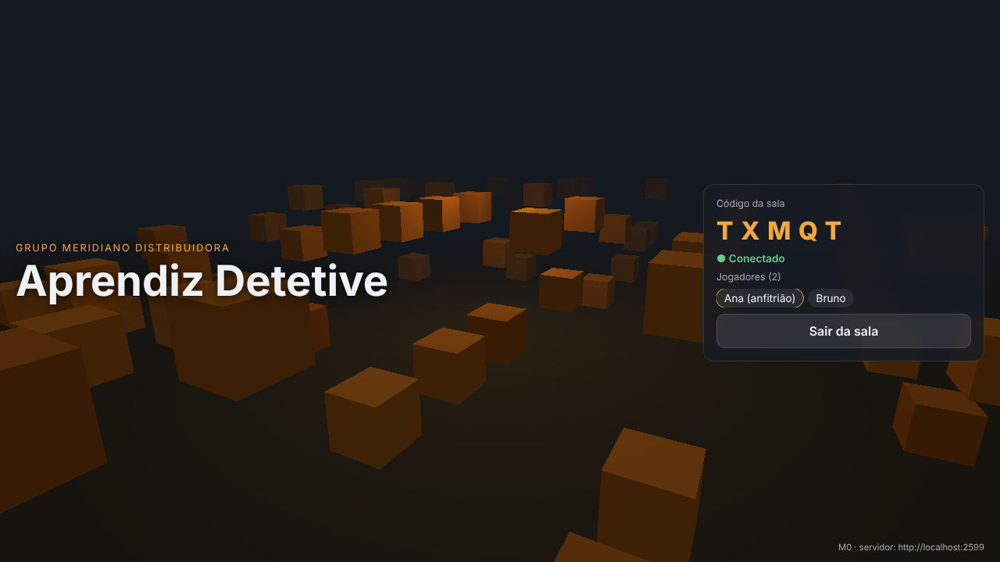

# Aprendiz Detetive

FPS multiplayer de investigação e traição no navegador (computador e celular).
Aprendizes investigam um rombo no **Grupo Meridiano Distribuidora** enquanto um ou mais impostores ocultam provas, sabotam, subornam e eliminam colegas.

## Status

**M0 concluído:** estrutura, CI e deploy. A página abre em desktop e celular (paisagem) e dois clientes entram na mesma sala por código.

| Marco | Entrega | Status |
|---|---|---|
| M0 | Estrutura, CI e deploy | ✅ |
| M1 | Movimento FPS desktop + mobile, Almoxarifado | ⬜ |
| M2 | Lobby e multiplayer sincronizado | ⬜ |
| M3 | Pistas, quadro de provas, papéis, votação — nível 1 | ⬜ |
| M4 | Combate, saque, eliminação, sequestro, sabotagem | ⬜ |
| M5 | NPCs, rendição/furto, procurado, área externa | ⬜ |
| M6 | Economia, suborno, níveis 2–5 | ⬜ |
| M7 | Polimento, áudio, presets de qualidade, tutorial | ⬜ |

| Desktop 1280×720 | Celular 844×390 |
|---|---|
|  |  |

## Como rodar

Requer Node 20 ou mais novo.

```bash
npm install

npm run dev      # desenvolvimento: servidor em :2567, cliente em http://localhost:5173
npm run host     # rede local: tudo em http://IP-DO-NOTEBOOK:2567 (celulares no mesmo Wi-Fi)
npm test         # Playwright: 2 clientes (desktop + celular paisagem) na mesma sala
npm run typecheck
npm run build
```

## Deploy

- **Cliente:** GitHub Pages via `.github/workflows/pages.yml`, a cada push na `main`.
  Link: `https://luishbsantos345-gif.github.io/Aprendiz-detetive-/` (só responde depois de ativar o Pages).
- **Servidor:** `render.yaml` (Render), `Dockerfile` + `fly.toml` (Fly.io/Railway).
- O cliente acha o servidor pela variável `VITE_SERVER_URL`.

Passo a passo em [`docs/DEPLOY.md`](docs/DEPLOY.md).

## Estrutura

```
client/   Vite + TypeScript + Three.js
server/   Node + Colyseus (autoritativo)
shared/   constantes e tipos usados pelos dois lados
tests/    Playwright
scripts/  modo host
docs/     DECISOES.md, ASSETS.md, DEPLOY.md
```

## O que falta

- Ativar o Pages e publicar o servidor (dependem da conta do dono do repositório, ver `docs/DEPLOY.md`).
- Teste em celular físico. O M0 foi validado em Chromium headless com viewport de celular, não em aparelho real.
- A imagem Docker foi escrita, mas ainda não foi construída em CI.
- Restringir o CORS do servidor à origem do Pages antes do M3.
- Todo o jogo em si: M1 em diante. A cena de caixas é provisória.

## Como usar o roteiro

Abra uma sessão do Claude com este repositório conectado e peça: **"Execute o marco M1"**. Um marco por sessão. A especificação completa está em [`PROMPT.md`](PROMPT.md).

## Stack prevista

Three.js + Vite + TypeScript (cliente) · Node + Colyseus (servidor autoritativo) · Rapier (física) · GitHub Pages (cliente) + Render/Railway/Fly.io (servidor).
